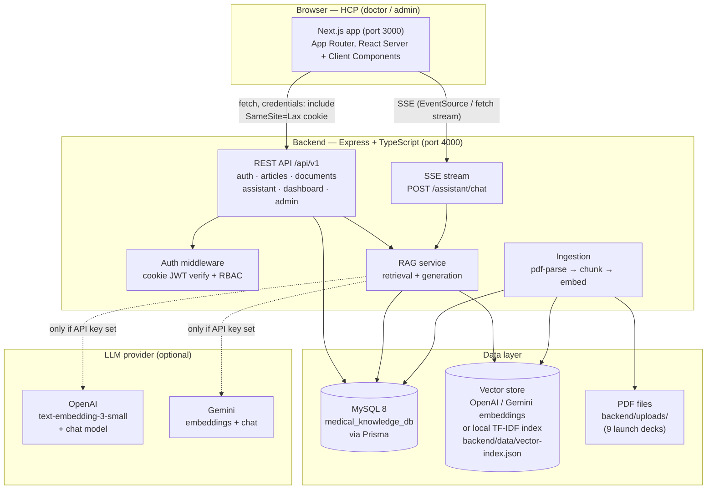

# Architecture — Cipla MedKnowledge Platform v2

> Status: this document describes the architecture defined in
> `shared/API_CONTRACT.md`. The implementation is being built in parallel;
> anything that depends on code that does not yet exist is marked
> **TODO / pending verification** rather than asserted as fact.

## 1. Overview

Cipla MedKnowledge v2 is a rebuild of the original Cipla MedKnowledge
Clinical Intelligence Platform (React 19 + Vite frontend, PHP 8.3 backend,
MySQL). The v2 stack is:

| Layer | Technology |
|---|---|
| Frontend | Next.js (14/15, TypeScript strict), port 3000 |
| Backend | Express + TypeScript + Prisma, port 4000 |
| Database | MySQL 8, database `medical_knowledge_db` |
| Vector / retrieval store | Separate from MySQL (see §5) |
| Auth | httpOnly cookie `mkp_session` (signed JWT, 8 h) |

The rebuild keeps the product scope identical — 9 verified clinical
publications / launch decks on cenobamate and epilepsy for physicians,
neurologists, and other HCPs — and replaces the PHP backend and the
placeholder AI assistant (which returned HTTP 503 in v1) with a working
retrieval-augmented generation (RAG) assistant.

## 2. System diagram



## 3. Component responsibilities

### 3.1 Frontend — Next.js (port 3000)

- App Router pages: login, dashboard, articles (list + detail), documents
  (list + PDF viewer), AI assistant (chat with citations), bookmarks,
  admin (users, document status, activity) — admin routes gated by role.
- Talks to the backend only through `/api/v1` with `credentials: include`.
  No auth token is ever stored in `localStorage` or `sessionStorage`.
- Static assets: Cipla logo at `/cipla-logo.svg`; the 9 PDFs are served
  from the backend, not from `frontend/public/documents/` — the copies
  under `frontend/public/documents/` are **TODO: confirm whether they are
  kept or removed**; the contract makes the backend the single source for
  file delivery (`GET /api/v1/documents/:id/file`).
- Design tokens (contract): primary `#075C67`, secondary `#148A91`,
  background `#F6F8F8`, surface `#FFFFFF`, heading `#172B35`,
  body `#52636B`, border `#E4EAEC`, success `#15803D`, warning `#B45309`,
  error `#DC2626`; font Inter; Lucide icons only; no gradients, no
  glassmorphism, no emoji icons. Collapsible sidebar, top nav, breadcrumbs.

### 3.2 Backend — Express + TypeScript (port 4000)

- Single Express app, routes mounted under `/api/v1` (see `docs/API.md`).
- Prisma ORM is the only database access layer; raw SQL is not used for
  application queries.
- Stateless auth: every protected route verifies the `mkp_session` JWT
  from the httpOnly cookie. No server-side session store.
- The assistant chat endpoint streams Server-Sent Events (SSE) and
  persists the conversation and messages.
- File delivery (`GET /api/v1/documents/:id/file`) is authenticated and
  streamed with HTTP `Range` support; PDFs are never exposed at a public
  URL.
- Swagger UI at `/api-docs` (**TODO: verify it is wired up in the
  implementation**).

### 3.3 Database — MySQL 8 via Prisma

Models (contract, `backend/prisma/schema.prisma` — **TODO: verify the
schema file matches the contract once the backend agent lands it**):

- `User` — id, name, email (unique), passwordHash, role
  (`doctor` | `admin`, default `doctor`), isActive, timestamps.
- `Category` — id, name (unique), slug (unique), description.
- `Article` — id, title, slug (unique), summary, category (string),
  content (LongText), status (`draft` | `published` | `archived`),
  pdfFileName, pdfPages, thumbnailUrl, publishedAt, timestamps.
  Indexes on slug, category, status.
- `Document` — id, title, fileName, mimeType, size, category, status
  (`pending` | `processing` | `ready` | `failed`), pageCount, version,
  uploadedById, timestamps.
- `DocumentChunk` — id, documentId (FK), page, section, content,
  chunkIndex, embeddingJson (nullable, local fallback), createdAt.
- `Conversation` / `Message` — per-user chat history; messages carry
  `citationsJson`.
- `Bookmark` — user + article, unique pair.
- `ActivityLog` — user activity (views, bookmarks).
- `AuditLog` — admin/security-relevant actions, with optional IP.
- `PasswordResetToken` — tokenHash, expiresAt, usedAt.

Dashboard counts (`GET /api/v1/dashboard`) are computed from the database
only — no hardcoded numbers.

### 3.4 RAG service — `backend/src/rag/`

- **Ingestion** (`backend/scripts/ingest.ts` + `backend/src/services/ingestion*`):
  `pdf-parse` extracts text preserving page numbers; text is chunked at
  ~800 tokens / ~3000 characters with ~200 characters overlap, split
  semantically at section headings where possible; chunks are stored in
  `DocumentChunk` with page and section metadata.
- **Embeddings**, in priority order:
  1. OpenAI `text-embedding-3-small` if `OPENAI_API_KEY` is set;
  2. Gemini embeddings if `GEMINI_API_KEY` is set;
  3. Local TF-IDF vectors, stored in `backend/data/vector-index.json`
     and held in memory, with cosine similarity.
- **Retrieval**: hybrid keyword + vector search, top 6 chunks, relevance
  threshold. If no chunk clears the threshold, the assistant must answer
  with exactly:

  > "I couldn't find sufficient information in the available Cipla medical
  > resources to answer this question reliably."

  plus a medical disclaimer. Citations may only cite retrieved chunks
  (real document, page, section, excerpt).
- **Generation**: an LLM is used only when a key is configured; without a
  key the fallback is extractive (answer assembled from retrieved
  chunks). **TODO: verify the exact no-key behaviour in the implementation
  — the contract implies extractive fallback but does not specify its
  wording.**
- **Isolation**: conversations are per-user; a user can only read their
  own conversations.

## 4. Data flows

### 4.1 Login

```
Browser → POST /api/v1/auth/login {email, password}
  → backend looks up User by email (Prisma)
  → bcrypt compare against passwordHash
  → on success: sign JWT (8 h), set httpOnly cookie mkp_session
    (Secure in prod, SameSite=Lax), write AuditLog
  → on failure: 401, generic message (no user-enumeration),
    failed attempt counted toward lockout (see docs/SECURITY.md)
Browser → GET /api/v1/auth/me → returns current user (no password hash)
```

### 4.2 Articles

```
Browser → GET /api/v1/articles?search=&category=&sort=&page=&limit=
  → Prisma query, published articles only for doctors
  → response { success, data: [...], meta: { page, total } }
Browser → GET /api/v1/articles/:slugOrId → article detail
Browser → POST /api/v1/articles/:id/viewed → ActivityLog row
Browser → POST /api/v1/articles/:id/bookmark → Bookmark upsert
```

### 4.3 Documents

```
Admin upload → POST /api/v1/documents (multipart, admin only)
  → file validated (type/size), stored in backend/uploads/,
    Document row created with status "pending"
  → ingestion pipeline: parse → chunk → embed → status "ready"
    (or "failed"; admin can POST /:id/reprocess)
Reader → GET /api/v1/documents → list (metadata only)
Reader → GET /api/v1/documents/:id/file
  → auth check → stream file bytes with Range support
  → no public URL, no direct filesystem path exposure
```

### 4.4 RAG chat

```
Browser → POST /api/v1/assistant/chat {conversationId?, question}
  → auth + per-user rate limit
  → retrieve top-6 chunks (hybrid keyword+vector, threshold)
  → if below threshold: fixed refusal + disclaimer (no LLM call)
  → else: build grounded prompt from retrieved chunks only
    → LLM (if key) or extractive fallback (if no key)
  → stream answer as SSE; persist Message rows with citationsJson
  → response includes citations [{documentId, documentName, page,
    section, excerpt, relevance}] and conversationId
```

## 5. Why the vector store is separate from MySQL

MySQL holds structured, relational data (users, articles, documents,
chunks' text and metadata). Embeddings and similarity search live
outside it because:

- MySQL 8 has no native vector index / ANN search; similarity over
  embeddings would be a full-table scan with application-side math.
- The TF-IDF fallback index (`backend/data/vector-index.json`) is a
  plain file the RAG service can load into memory at startup — simple,
  fast for a 9-document corpus, and independent of the database.
- When an embedding provider is configured, its vectors are the
  retrieval index; MySQL only keeps the chunk text and (optionally) the
  embedding JSON as a cache (`DocumentChunk.embeddingJson`).
- Separation keeps the relational schema stable if the embedding
  provider changes, and keeps PII-free chunk text out of any third-party
  vector database.

This is a deliberate trade-off: at this corpus size (9 PDFs) a dedicated
vector database (pgvector, Pinecone, etc.) would add operational cost
with no measurable benefit. If the corpus grows past a few hundred
documents, revisit a dedicated vector store.

## 6. Why Express + TypeScript (not NestJS)

The contract allows Express + TypeScript, and that choice was kept:

- **Scope fit.** The API surface is ~25 endpoints with one cross-cutting
  concern (cookie JWT auth + admin RBAC). NestJS's module/DI/decorator
  machinery would add structure without adding capability.
- **Team and codebase continuity.** The original backend was plain PHP
  procedural handlers; Express route handlers map 1:1 onto that shape,
  making review and onboarding cheaper.
- **Explicitness over magic.** Middleware ordering (helmet → CORS →
  rate limit → cookie parse → auth → routes → error handler) is visible
  in one file, which matters for the security review in `docs/SECURITY.md`.
- **Ecosystem.** Prisma, `pdf-parse`, SSE streaming, and the OpenAI /
  Gemini SDKs all have first-class Express examples; nothing in the
  contract needs NestJS-specific features (GraphQL, websockets gateway,
  microservices transport).
- **Cost.** Smaller dependency tree, faster cold starts on Render's free
  tier, simpler Dockerfile.

The trade-off is discipline: without NestJS's opinionated structure, the
backend must keep route handlers thin and push logic into services
(`src/services/`, `src/rag/`). That convention is enforced by code
review, not by the framework.

## 7. Auth and RBAC

- Roles: `doctor` (default) and `admin`.
- Every `/api/v1/*` route except `/auth/login`, `/auth/forgot-password`,
  `/auth/reset-password`, and `/health` requires a valid `mkp_session`
  cookie.
- Admin-only routes: `POST /api/v1/documents`, `DELETE /api/v1/documents/:id`,
  `POST /api/v1/documents/:id/reprocess`, and all `/api/v1/admin/*`.
  Enforcement is server-side middleware (`requireAdmin`), never
  client-side hiding alone.
- No Gmail-domain auto-auth (a v1 behaviour that is explicitly removed
  in v2). Only seeded / admin-created accounts can log in.
- Password reset uses single-use, hashed, expiring tokens
  (`PasswordResetToken`); the plaintext token is only ever sent by email
  (**TODO: verify the email-sending mechanism — the contract defines the
  endpoints but no mail provider**).

## 8. Security boundaries

| Boundary | Control |
|---|---|
| Browser ↔ backend | HTTPS in prod; CORS allow-list = frontend origin only, `credentials: true`; `SameSite=Lax`, httpOnly, Secure cookies |
| Backend ↔ MySQL | Prisma parameterized queries only; credentials via `DATABASE_URL` env var; least-privilege DB user in prod |
| Backend ↔ LLM provider | API key via env var only, never in code or logs; chunk text only — no user PII sent to the provider beyond the question itself |
| Backend ↔ filesystem | Uploads restricted to `backend/uploads/`; file type/size validation; served only through the authenticated streaming endpoint |
| Admin ↔ system | Role check on every admin route; admin actions written to `AuditLog` |

See `docs/SECURITY.md` for the full control list.

## 9. Deployment topology (summary)

- Render Blueprint (`render.yaml` at repo root — **TODO: verify it has
  been created; it did not exist at the time of writing**):
  `cipla-medknowledge-backend` (Node web service, Docker) +
  `cipla-medknowledge-frontend` (static site, `next build` output) +
  managed MySQL (or external MySQL host — see `docs/DEPLOYMENT.md`).
- Locally: frontend on `:3000`, backend on `:4000`, MySQL on `:3306`.

## 10. Known gaps / pending verification

- `render.yaml`, backend `package.json` / `tsconfig` / Prisma schema,
  and frontend `package.json` did not exist when this document was
  written (parallel agents in progress). Statements about them are
  contract-derived, not observed.
- Whether the `frontend/public/documents/` PDF copies are retained or
  removed in favour of backend streaming.
- The email provider for password reset.
- Exact no-LLM-key (extractive fallback) answer wording.
- Swagger (`/api-docs`) wiring.
